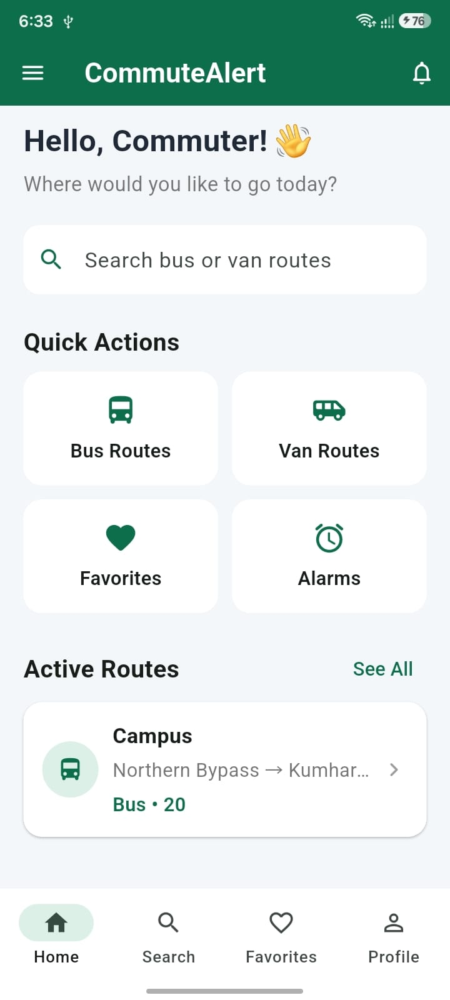
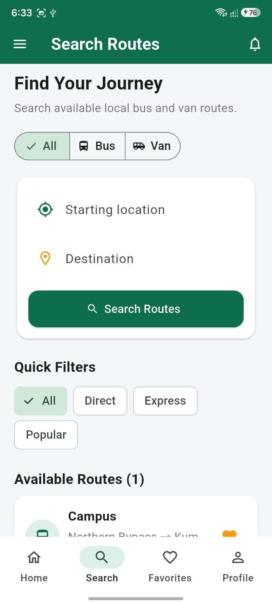
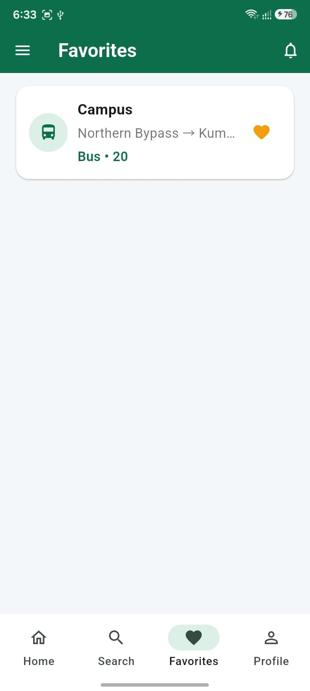
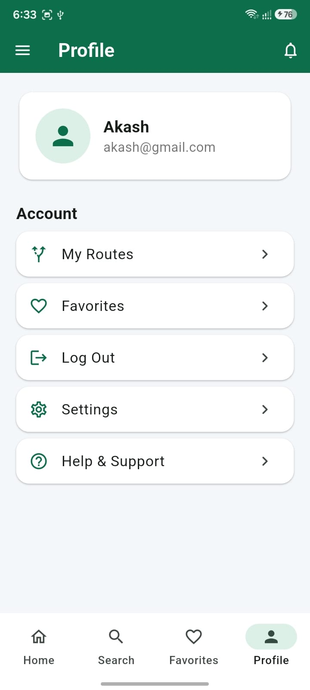
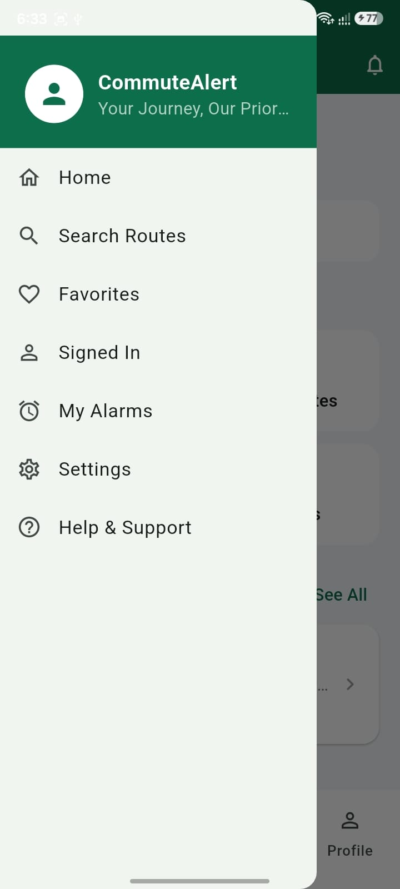

# CommuteAlert

CommuteAlert is a Flutter mobile application for discovering local bus and van
routes, reviewing route stops and timetables, saving favorites, and creating
timer or location-based travel alarms.

## Project objectives

- Provide an organized mobile view of active transport routes.
- Preserve departure, arrival, fare, transport, stop, and timetable data.
- Support email/password authentication and administrator-only route
  management.
- Provide local favorites and locally persisted alarms.
- Notify users about journey times and nearby stops.

## Key features

- Active bus and van route discovery.
- Case-insensitive route search and transport/direct/express/popular filters.
- Route details, timetable, and stop views.
- Local favorite-route persistence with duplicate prevention.
- Firebase Email/Password authentication.
- Firestore role-based administrator route management.
- Journey timer alarms with repeat-day scheduling.
- Location stop alerts with GPS, distance threshold, and foreground monitoring.
- Android notification channels and notification tap handling.
- Firestore cache support and an offline status banner.

## Technology stack

- Flutter and Dart
- Firebase Core
- Firebase Authentication
- Cloud Firestore
- Shared Preferences
- `geolocator`
- `flutter_local_notifications`
- Timezone and Flutter Timezone packages

## Project folder structure

```text
lib/
├── main.dart
├── firebase_options.dart
├── models/
├── screens/
├── services/
├── theme/
└── widgets/
android/
├── app/src/main/AndroidManifest.xml
├── app/google-services.json
└── app/build.gradle.kts
test/
firestore.rules
firebase.json
```

## Firebase setup

The existing Firebase project is `commutealert-b0561`. FlutterFire
configuration is stored in `lib/firebase_options.dart`, and Android uses
`android/app/google-services.json`.

In Firebase Console:

1. Enable Authentication > Sign-in method > Email/Password.
2. Create the required Firestore collections: `routes`, `stops`, and
   `timetables`. User profiles are stored in `users`.
3. Deploy `firestore.rules` using:
   ```shell
   firebase deploy --only firestore:rules --project commutealert-b0561
   ```
4. Create the first standard account in the app.
5. Open `users/{Firebase UID}` in Firestore Console and set `role` to the
   string `"admin"`. Do not use an array or list.

Never add a Firebase Admin SDK private service-account key to this repository.
The Flutter Firebase configuration files contain client configuration, not
server administrator credentials.

## Firestore route fields

Routes must include:

- `routeId`: string, identical to the Firestore document ID
- `routeName`: non-empty string
- `transportType`: `bus` or `van`
- `startLocation`: non-empty string
- `destination`: non-empty string
- `departureTime`: string
- `arrivalTime`: string
- `estimatedDuration`: string
- `fare`: number greater than zero
- `isActive`: boolean

Stop and timetable documents should include the fields referenced by
`lib/models/stop_model.dart` and `lib/models/timetable_model.dart`.

## Android permissions

`android/app/src/main/AndroidManifest.xml` declares:

- `POST_NOTIFICATIONS`
- `ACCESS_COARSE_LOCATION`
- `ACCESS_FINE_LOCATION`

Location permission is requested only when a location alarm starts. GPS,
notification, battery optimization, and manufacturer-specific background
settings remain controlled by Android and the device.

## Installation and run

Requirements:

- Flutter and Dart compatible with `environment.sdk: ^3.12.2`
- Android SDK
- Android emulator or physical Android device
- Internet access for first Firestore synchronization

```shell
flutter pub get
flutter analyze
flutter run
```

For a release build:

```shell
flutter build apk --release
```

The release APK is created at:

```text
build/app/outputs/flutter-apk/app-release.apk
```

## Testing

Automated verification commands:

```shell
flutter pub get
dart format .
flutter analyze
flutter test
flutter build apk --release
```

The splash-screen widget test is included. Device testing is still required
for GPS, notifications, alarm delivery, Android background behavior, login,
offline synchronization, and physical Firebase data.

## Screenshots

Screenshots captured from the application:

### Home



### Search



### Favourite



### Profile



### Sidebar



## Known limitations

- Background location tracking and exact alarm delivery depend on Android
  battery optimization and vendor-specific restrictions.
- Alarm and favorite persistence is local; favorites and alarms are not
  synchronized through a per-user cloud account.
- Notification delivery is not guaranteed if Android permission or battery
  restrictions block it.
- Live offline behavior depends on route documents previously synchronized
  by Firestore.
- The release build currently uses the Android debug signing configuration
  unless a private release keystore is configured.

## Future improvements

- Add integration tests for route search and alarm workflows.
- Add server-authorized role assignment instead of manual Firestore role setup.
- Synchronize favorites and alarms with signed-in user accounts.
- Add exact alarm scheduling and Android scheduling permission handling.
- Add background location support with explicit user consent and Android
  foreground-service requirements.
- Add admin screens for editing and deleting routes.
- Add verified transport timetable datasets.
